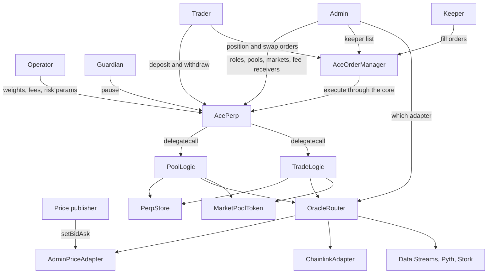

# Ace

Ace is a Solidity perpetuals protocol for Robinhood Chain. One shared LP pool holds a collateral
set, and one or more perp markets trade against that pool.

> **Status:** functional, tested prototype. It has not been independently audited and must not hold
> production funds until it has completed protocol-specific economic testing and a security audit.
> `poolLogic` and `tradeLogic` are fixed in the core constructor, so a deployed core does not pick
> up later source changes.

## How the modules fit

Traders talk to the core for liquidity and to the order manager for positions and swaps. Keepers
only fill those orders. The core delegatecalls pool and trade logic, which share `PerpStore` state
and read prices through the router.



`AcePerp` holds no pool or trade math of its own. A call such as `depositLiquidity` or
`executeOrderIncrease` is delegatecalled into `PoolLogic` or `TradeLogic`, so both libraries read
and write the core's storage. Direct `swap` on the core reverts. The order manager escrows the
trader's input and is the only caller.

## What is included

- one shared LP pool per collateral set, with one or more perp markets on that pool;
- position increase, collateral add/withdraw, partial/full close, minimum remainder, and liquidation;
- borrow charged only on the heavier open-interest side, on the full position size, at
  `borrowingFactorPerSecond` times that side's share of pool value, capped at 100% utilization;
- funding from open-interest skew. The heavier side pays per eight hours. There is no LP-PnL
  funding mode;
- a path-integrated price-impact model that charges skew-increasing trades and rebates
  skew-reducing trades, both applied in the execution price;
- trading fees, and the protocol share of borrow, routed to treasury, insurance, the keeper
  receiver, and LPs;
- market, limit, stop-loss, and take-profit orders, plus swap orders. A trader escrows the order.
  A keeper fills it. An empty keeper list is permissionless. A non-empty list is an allowlist;
- target weights, a path-integrated weight fee, and an optional hard weight band. A swap that
  increases the pair's deviation reverts. A swap that removes the overweight asset can pay an
  inventory premium, and that premium stops at the target weight;
- a withdrawal pays only from that token's vault and cannot exceed that vault's value;
- a loss-protection vault that can take a cut of trader losses and fund a share of wins;
- a function mask and a `migrate` entrypoint that advances the version by one;
- an oracle router with bid/ask prices, action-specific age limits, order timestamp binding,
  market status, failover, cross-source checks, and a historical-deviation circuit breaker;
- Chainlink Data Feeds with a weekday session clock, verified Data Streams, and same-transaction
  Pyth or Stork updates;
- separate admin, operator, guardian, price-publisher, and keeper roles.

## Roles

| Role | What it can do |
| --- | --- |
| Admin | Owner of the core, the order manager, the router, and each admin price adapter. Creates pools and markets, assigns the other roles, sets fee receivers, the loss-protection vault, the function mask, and migrations. |
| Operator | Changes parameters: target weights, the weight fee, the inventory premium, the weight band, market config, price impact, funding, vault bounds, whether a market is enabled, and the minimum execution fee. The admin can still change these. |
| Guardian | Pauses the protocol. Pause blocks opening or increasing a position. Closes and liquidations still settle. The guardian can also disable a single market. |
| Price publisher | Calls `setBidAsk` on `AdminPriceAdapter`. Until a publisher is set, the adapter owner can publish. After `setPublisher`, the owner cannot. |
| Keeper | Fills position orders and swap orders. The keeper is not the swap counterparty. Tokens come from the trader and the output goes back to the trader. |

## Fees

Borrow replaces the old per-vault reserving multiplier. `setReservingFee` is gone. If long and short
open interest are equal, nobody pays. The lighter side never pays. The factor is per second at
100% of pool value. Pool value in the denominator is the vaults' cash and escrow. The live
deployment script leaves the factor at 0.

Funding mode `0` is off. Mode `1` is the open-interest skew rate, capped by `fundingMaxRateWad`.
Mode `2` reverts.

Price impact uses the change in a potential of `|long − short| / max OI`:

```text
potential(skew) = maxOI * impactFactor * (min(|longOI - shortOI| / maxOI, 1) ^ exponent)
impactUSD        = potential(before) - potential(after)
impactRate       = impactUSD / tradeSize
```

A negative rate is a worse fill. A positive rate is a better fill, capped by `maxRebateWad`. A base
spread is added against the trader on every fill. Splitting one order does not reduce the total,
apart from integer rounding. Exponents are 1 or 2. The rebate is paid immediately out of the fill.
It is not stored for a later claim.

The weight fee on a deposit, withdrawal, or swap is the base rate on the amount, plus the increase
in a potential of the vault's distance from its target. Moving closer to the target pays the base
only. Charging the potential means several small deposits cannot cost less than one deposit of the
same size. `weightBandBps` of zero disables the hard band. A non-zero band reverts an LP deposit or
withdrawal that pushes a vault further past that distance.

## Oracle model

`OracleRouter` maps a protocol asset id to a primary adapter and an optional secondary. It supports:

- primary-only reads;
- primary reads with automatic fallback;
- both-sources-required reads;
- maximum price age and maximum cross-source deviation;
- conservative min and max prices;
- a requirement that an execution price was published no earlier than the order;
- a historical price-deviation breaker.

Opens use `getPriceForAction` and revert when the feed reports the market closed. Closes,
liquidations, withdrawals, and swap orders use `getPriceAllowingClosed`, so they settle on the last
accepted print.

`ChainlinkAdapter` can require a weekday UTC session. The US cash constants are 13:30 to 21:00 UTC,
which covers both daylight-saving schedules. A price older than `sessionHeartbeat` is treated as
closed even inside that window. `alwaysOpen` skips the clock. `AdminPriceAdapter` is the manual
bid/ask source used where a Chainlink proxy is not deployed.

`ChainlinkDataStreamAdapter` submits a signed payload to the configured verifier and stores the
verified bid and ask. Pyth uses price ± confidence and Stork uses its 1e18 value. Both accept an
update in the same transaction as execution.

Robinhood Chain mainnet publishes the push feeds. RHAMZN/USD
(`0xD5a1508ceD74c084eBf3cBe853e2C968fB2a651C`) is the stock token's total-return price, not the
cash print. USDG/USD is `0x61B7e5650328764B076A108EFF5fa7282a1B9aD2`. Neither proxy has code on
testnet 46630. `script/ConfigureChainlink.s.sol` deploys a session adapter for AMZN and an
always-open adapter for USDG, and reverts with `TestnetFeedMissing` on testnet while those
proxies are empty.

## Isolated pool accounting

Each pool lists the tokens it accepts and deploys one `MarketPoolToken`. Long and short are
position directions, not separate vaults. Several markets can share that pool. Trader margin sits
on the position. LP coins escrowed for that position sit on the token vault. The LP price is:

```text
sum of each token vault (LP cash + escrowed LP coins)
  + unpaid funding
  + the LP share of unpaid borrow
```

Trader margin and open mark-to-market stay outside this price. Open profit does not move the LP
price until it settles, and a settled profit is capped by the coins escrowed for that position.
A withdrawal in one token cannot take more than that token's own vault value. Markets on the same
pool share its LP token and its per-token vaults.

## Build and test

Foundry is required.

```bash
forge build
forge test --offline
```

The suite covers a shared pool, multiple markets, transferable shares, borrow that bills only the
heavier side, open-interest funding, rejection of the removed funding mode, weight fees, the weight
band, keeper-filled swaps, inventory premium, loss protection, position changes, orders, price-impact
path independence, oracle timestamp and market-status rules, the equity session clock, sequencer
checks, Data Streams verification, and Pyth/Stork updates.

## Robinhood Chain

| Network | Chain ID | RPC |
| --- | ---: | --- |
| Mainnet | 4663 | `https://rpc.mainnet.chain.robinhood.com` |
| Testnet | 46630 | `https://rpc.testnet.chain.robinhood.com` |

Robinhood Chain is EVM-compatible and supports normal Foundry deployment. See the official
[deployment guide](https://docs.robinhood.com/chain/deploy-smart-contracts/) and
[Chainlink Data Streams page](https://docs.robinhood.com/chain/data-streams/).

Copy `.env.example`, use a throwaway testnet deployer, and run:

```bash
source .env
forge script script/Deploy.s.sol:Deploy \
  --rpc-url "$RH_TESTNET_RPC_URL" \
  --broadcast
```

`Deploy` deploys `OracleRouter`, `PoolLogic`, `TradeLogic`, `AcePerp`, and `AceOrderManager`, then
points the core at the order manager. Collateral tokens, oracle feeds, pools, and markets are
configured afterward. Create a pool with the tokens it should accept, register a price for each
asset id, then attach one market. For an NVDA perp margined in NVDA or USDG, the pool lists both
tokens and the market's index asset is NVDA.

Verify token and feed addresses, heartbeat, decimals, and risk parameters before pointing a market
at them. Opens must observe the venue session. A recent price is not proof that the cash market is
open. Closes and liquidations are allowed on the last print so a closed session does not trap a
position.

## Main contracts

- `src/AcePerp.sol` — entrypoint, roles, pool and market creation.
- `src/PerpStore.sol` — shared storage, positions, borrow, funding, and weight fees.
- `src/PoolLogic.sol` — deposits, withdrawals, keeper-filled swaps, and LP price. Delegatecalled.
- `src/TradeLogic.sol` — increase, decrease, and liquidation. Delegatecalled.
- `src/AceOrderManager.sol` — position orders, swap orders, and the keeper allowlist.
- `src/market/MarketPoolToken.sol` — transferable LP share and pool vault.
- `src/libraries/PriceImpactModel.sol` — execution-price model.
- `src/oracles/OracleRouter.sol` — source selection, session enforcement, and the circuit breaker.
- `src/oracles/AdminPriceAdapter.sol` — publisher-owned bid/ask.
- `src/oracles/ChainlinkAdapter.sol` — Chainlink Data Feeds and the cash-session clock.
- `src/oracles/ChainlinkDataStreamAdapter.sol` — verified signed bid/ask reports.
- `src/oracles/PythAdapter.sol` and `src/oracles/StorkAdapter.sol` — same-transaction price updates.

See [SECURITY.md](SECURITY.md) for assumptions and pre-production work.
